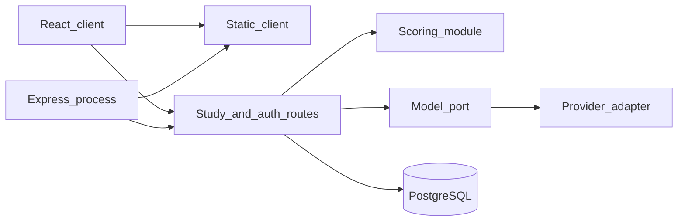
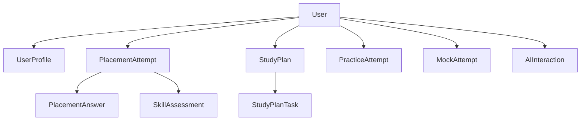

# Bandora implementation roadmap

Status: 2026-11-05. This is the approved sequence. `docs/implementation-roadmap.md` is an older execution log and is not the plan.

No dates are promised. A phase starts when the previous phase’s definition of done is met, except Phase 1, which may proceed on the prototype before Phase 2 because it does not need a database.

## Current facts the plan must respect

- React 19, TypeScript, Vite 7, and Express 4 already run from `server.js` on port 38471.
- Express serves the client and `GET /api/health`. It does not authenticate.
- Scores and accounts live in `localStorage` (`ielts-readiness-state`).
- `db/migrations/001_initial.sql` creates users, sessions, profiles, placement attempts, answers, and skill results. It has not been applied. `DATABASE_URL` only changes the health JSON.
- The assistant is `assistantReply`. Writing and speaking grades in `lib/model.ts` are heuristics with `simulated: true`.
- Admin authorization is `canOpen` plus a button that sets the demo role.
- NOVI renders on the dashboard only.

## Decision: keep Express and extend it

A rewrite is not justified. The learner UI, scoring module, and routes already match the product. Replacing them would throw away `buildView` and the placement gate.

The production shape is the same Node process:

- `server.js` remains the entry. It keeps the static client and the health route.
- HTTP routes for accounts, study data, and model calls are added beside it when Phase 2 starts. They are not added in Phase 0.
- PostgreSQL is the system of record for those routes.
- The React app calls those routes. It does not open a database connection and does not embed a provider key.
- A second deployable service is optional later if model traffic needs its own scale. It is not required to start.

Trade-off: one process is simpler to operate and shares types with the client. The cost is that a slow provider must not stall page requests. The model call needs its own timeout. A separate worker is not required for the MVP if that call is a normal async request with a timeout.

`docs/architecture.md` suggested a separate backend as the long-term picture. This decision keeps that option and refuses a big-bang split. `docs/decisions.md` D6 points here.

`docs/api.md` stays the proposed route list. Phase 2 implements the subset in this file and adds the model routes from `docs/PRODUCT_SPEC.md` section 16. Nothing in `docs/api.md` is live today. Its note that a speech service waits until a later version still applies to audio and pronunciation. Typed speaking feedback is MVP scope and does not wait on that audio service.

## Production architecture



| Piece | Responsibility |
| --- | --- |
| Frontend | Routes, forms, NOVI, theme, language, calling Bandora HTTP, showing loading and fallback. No provider key. No role elevation |
| Backend | Sessions, authorization, validation, scoring of stored attempts, plan versioning, model policy, audit |
| API | JSON. Errors as `{ "error": { "code", "message" } }` already specified in `docs/api.md`. 400, 401, 403, 404, 409, 429, 503 |
| Database | Users and study rows. Not files, not sessions in `localStorage` once Phase 4 has moved that account |
| Model port | One interface. Adapters are replaceable. Prompts live on the server |
| Auth | httpOnly session, `password_hash`, server role. Client role field is ignored |
| Validation | Shared checks at the route. The browser checks are a convenience, not the boundary |
| Errors | Stable codes. Fallback UI from `docs/USER_FLOWS.md` |
| Logging | Request id, user id, status, latency. Model logs add use-case id and size. No essay body, no key, no password |
| Tests | Unit tests for scoring and for the model validator with a fake adapter. Route tests for 401 and 403. One browser journey for signup through report when a runner is added |
| Deploy | Not chosen (Q-02). The Node process needs `DATABASE_URL` and the provider secret. The client build needs neither |

### Proposed folders

These folders are not created by this documentation task.

```text
server.js                      entry, keep
server/http/                   auth, placement, plan, attempts, model routes
server/ai/                     port, prompts, limits, adapter
db/migrations/                 001 exists; later files add plan, attempts, model turns
lib/model.ts                   scoring rules, called by the client today and by the server later
components/                    current UI
```

### Entities

Essential for MVP, mapped to what already exists in SQL when it does:

| Entity | MVP | Already in `001_initial.sql` | Notes |
| --- | --- | --- | --- |
| User | Yes | `users` | Add a server role column before any admin release. Learners are the only public role |
| Session | Yes | `sessions` | Store the token hash, as the file already does |
| UserProfile | Yes | `profiles` | Exam type, target, minutes, days, exam date. Phone and age exist on the prototype account and are optional on the server |
| StudyGoal | Fold into UserProfile | — | A separate table is not needed |
| PlacementAttempt | Yes | `placement_attempts` | |
| Placement answer | Yes | `placement_answers` | |
| SkillAssessment | Yes | `skill_results` | Keep `simulated` until a row truly comes from the model |
| StudyPlan | Yes | Not in 001 | One active plan per user |
| StudyPlanTask | Yes | Not in 001 | Editable status and size. Version on the plan |
| PracticeAttempt | Yes | Not in 001 | Item id, skill, score, time |
| MockTest | Content can stay in the repo | Not in 001 | A table is only needed when papers are edited without a deploy |
| Mock attempt | Yes | Not in 001 | Same idea as practice, plus section scores |
| ProgressSnapshot | Derive first | Not in 001 | Compute from attempts. Store a row only if history becomes slow |
| AIInteraction | Yes | Not in 001 | User, use case, input reference, validated output, created time |
| Question and QuestionVersion | P1 | Not in 001 | Required before staff edit live items. Not required to keep shipping the repo bank |
| Subscription | No | Not in 001 | Post-MVP |



## Phase 0 — Product and UX foundation

| | |
| --- | --- |
| Objectives | Record the approved decisions and the gap between the prototype and production |
| Deliverables | This file, `PRODUCT_SPEC.md`, `UX_ARCHITECTURE.md`, `USER_FLOWS.md`, `MVP_SCOPE.md` |
| Dependencies | The repository as it is |
| Risks | Older docs contradict the new AI decision. Those files now point here |
| Definition of done | The five files exist. P0 items have acceptance criteria. No application file changed for this phase |
| Tests | Read-through against `src/routes.tsx`, `lib/capabilities.ts`, and `server.js` |

## Phase 1 — UX and visual design

| | |
| --- | --- |
| Objectives | Bring the study plan and the placement report up to the NOVI rules. Tighten hierarchy one page at a time. Do not add a model |
| Deliverables | NOVI on `/plan` and `/placement/report`. Silent timed screens confirmed. The assistant remains labeled as not a language model |
| Dependencies | Phase 0. Artwork files already in `public/assets/novi/` |
| Risks | Cropping or recoloring NOVI. Putting NOVI on practice. Treating a template reply as AI-05 |
| Definition of done | The three placements match `docs/UX_ARCHITECTURE.md` section 3. Dashboard behavior and scoring stay as they are. Reduced motion still disables float |
| Tests | Extend `lib/novi.test.ts` if the resolver rules change. Browser check of dashboard, plan, report, and one timed skill on a narrow and a wide viewport |

Pages, in order: dashboard (already started), placement report, study plan, then auth honesty copy, then practice result labels. Do not restyle admin.

## Phase 2 — Backend foundation

| | |
| --- | --- |
| Objectives | Real accounts and stored study data |
| Deliverables | Applied migrations, starting from `001_initial.sql` plus plan and attempt tables. Routes: register, login, logout, me, placement start, answers, submit, report, plan get and patch. Password reset can follow in the same phase if Q-03 is answered, otherwise it stays P1 and the demo forgot-password screen stays labeled |
| Dependencies | Q-02. A Postgres instance the team controls. Phase 0 |
| Risks | Applying 001 to a database that was not empty. Shipping the role-switch button next to real accounts. GitHub Pages cannot run this API (`docs/deployment-decision.md`) |
| Definition of done | A second browser can log in and see the same profile. 401 and 403 tests pass. Health can report a real connectivity check rather than only “the variable is set” |
| Tests | Migration apply and rollback on a disposable database. Route tests. Existing `lib/model.test.ts` still green. One fixture scored through the server module |

The prototype’s local login remains available until Phase 4 switches the shell to the session, so the demo does not break in the middle of backend work.

## Phase 3 — Real model integration

| | |
| --- | --- |
| Objectives | AI-01 through AI-05 behind the model port |
| Deliverables | Provider adapter chosen via Q-01, prompt templates, JSON schema checks, daily caps, timeout, fallback, redacted logs |
| Dependencies | Phase 2 session, so limits attach to a user. Q-01 answered with a ceiling and a data-processing answer |
| Risks | Calling the provider from React. Logging essays. Showing a heuristic as a model result. Unbounded spend |
| Definition of done | The five use cases meet section 16 of `docs/PRODUCT_SPEC.md`. The key is only in the server environment. A forced provider error shows the deterministic fallback |
| Tests | Fake adapter in unit tests: valid output, official-score wording stripped, unknown task id rejected, cap enforced, timeout path. No test calls a paid provider unless a human runs that check on purpose |

## Phase 4 — Core product integration

| | |
| --- | --- |
| Objectives | The learner path reads and writes the server |
| Deliverables | Onboarding, placement, dashboard, plan, practice, mocks, and reports use the API. `buildView` stays the single view builder, fed by server data. Local storage is reduced to device preferences |
| Dependencies | Phases 2 and 3 |
| Risks | Two sources of truth during the switch. A failed migration of the demo account |
| Definition of done | The P0 rows in `docs/MVP_SCOPE.md` section B are true on the server. The sample lab is not required for the main path |
| Tests | Browser journey: signup, onboarding, four skills, locked-then-open report, plan edit, one practice submit, one writing feedback, refresh, data still there |

## Phase 5 — Admin and operational readiness

| | |
| --- | --- |
| Objectives | Remove the fake role switch. Observe the system |
| Deliverables | Either server-enforced admin with an audit log, or admin routes deleted from the public build. Request logs, model usage totals, backup restore tried once |
| Dependencies | Phase 2 at minimum for auth. Phase 3 for model totals |
| Risks | Leaving `setRole("system_admin")` in the client |
| Definition of done | A learner token cannot open an admin route. A public build contains no promote control |
| Tests | 403 test for each admin route. A search of the client for the promote control |

## Phase 6 — QA and public release

| | |
| --- | --- |
| Objectives | Prove the release gate in `docs/MVP_SCOPE.md` section D |
| Deliverables | Security pass on auth and the model proxy, accessibility pass on the learner path, narrow and wide layouts, backup, and a rollback note |
| Dependencies | Q-02 answered. Phases 1–5 |
| Risks | Publishing Pages-only and calling it the MVP. The API will not be there |
| Definition of done | P0 acceptance criteria checked off. Disclaimer present. Admin rule satisfied. Rollback tried on a staging process |
| Tests | The Phase 4 journey plus keyboard-only placement, reduced motion, and a model outage |

## What this roadmap refuses

- Implementing the database or the model during Phase 0 or Phase 1.
- Choosing a paid provider or a host inside the docs.
- Replacing the React app.
- Treating `docs/api.md`, `docs/database-design.md`, or the admin screens as finished production.
