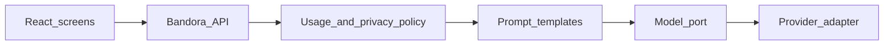

# Bandora product specification

Status: approved direction, 2026-11-05. This file is the product source of truth for what to build next.

Current behavior still comes from the code. If this file and the running prototype disagree about what the browser does today, the code wins. If this file and an older doc disagree about the target, this file wins.

Older contracts that remain useful and are not rewritten here: `docs/prd.md` (prototype FR-01–FR-25), `docs/problem.md`, `docs/personas.md`, `docs/scoring.md`, `docs/capability-matrix.md`.

## 1. Vision

A Persian-speaking candidate preparing for IELTS without a private tutor can see one unofficial picture of their level, the gap to their goal, and the next piece of work, and can get a real model’s feedback on writing and speaking without mistaking any of it for an official IELTS result.

## 2. Mission

Bandora plans the week and explains the gap. NOVI is the companion that says the next step in a human tone. The product never issues an official score and never claims affiliation with IELTS.

## 3. Audience and personas

Primary user: an independent candidate, Persian-speaking, Academic or General Training, studying on a phone or laptop. Evidence: `docs/prd.md` and `docs/personas.md`.

| Persona | In the product now | Production role |
| --- | --- | --- |
| Learner | Demo account, role `learner` | The only public account |
| Content manager | Demo role, sees some admin routes | No public release until server authorization exists |
| System admin | Demo role, sees all `/admin` routes, and any learner can press a button to become this role | Server role only. The button must not exist in production |
| Support agent | Demo role, feedback routes only | Same rule as system admin |

Sample learner used by the prototype: Negar Hosseini, `negar@example.com`, scenario B. Sample admin: `admin@example.com`. Neither is a production account.

## 4. Problems

From `docs/prd.md` and `docs/problem.md`, still accurate:

- The candidate cannot see level, gap, and this week’s work in one place.
- A single overall number hides the weak skill.
- A private tutor is not assumed.

This package adds a problem the prototype does not solve: writing and speaking feedback in the browser is a heuristic (`lib/model.ts` sets `method: "heuristic"` and `simulated: true`) or a keyword template (`lib/signals.ts`). That is not a language model.

## 5. Value proposition

- One unofficial estimate with a range and a confidence figure.
- A study plan the candidate can edit, with skill coverage that changes when the plan changes.
- A server-side model that explains writing, a typed speaking answer, and the next study step.
- NOVI states that next step on the dashboard, the plan, and the placement report. NOVI is not the model.

## 6. Principles

1. Bandora is the product name. NOVI is the companion. Source: `lib/brand.ts`.
2. The visual system is institutional editorial: warm ivory, deep ink, muted sage, and soft beige. Light is the default. Dark uses the same inks. NOVI's painted body stays its own artwork.
3. The browser prototype stays runnable. Backend work does not start in the documentation phase.
4. Production data, sessions, and model calls live on Node.js and PostgreSQL. The React app does not hold a model API key.
5. An estimate is labeled unofficial. Writing and speaking model output is a preliminary estimate.
6. Timed placement, practice, and mocks do not show NOVI.
7. Admin in the prototype is an experiment. Before public release it is either enforced on the server or removed.
8. Simulated screens stay labeled simulated until the production behavior exists.

## 7. Functional requirements

Priority: P0 is required for the production MVP. P1 is important and not launch-blocking. P2 is later.

Status words describe the repository today, not the target.

| ID | Priority | Requirement | Status today | Evidence |
| --- | --- | --- | --- | --- |
| PR-01 | P0 | Product name Bandora, companion name NOVI, IELTS non-affiliation disclaimer | IMPLEMENTED | `lib/brand.ts` |
| PR-02 | P0 | Persian and English, RTL and LTR, light and dark, text size, reduced motion | IMPLEMENTED | `lib/capabilities.ts`, `app/globals.css` |
| PR-03 | P0 | Landing explains the unofficial estimate and starts signup or the sample | IMPLEMENTED | `components/features/landing.tsx`, route `/` |
| PR-04 | P0 | App shell stays closed until an account object exists, then onboarding until `onboardingDone` | IMPLEMENTED as a browser gate, SIMULATED as authentication | `components/shell/app-shell.tsx` |
| PR-05 | P0 | Signup collects name, email, phone, age, and a password of at least 8 characters with one digit. The password is not stored | IMPLEMENTED validation, SIMULATED account | `components/features/auth.tsx`, `Account` in `lib/types.ts` has no password |
| PR-06 | P0 | Production sign-in is a server session. The password is hashed. The client cannot choose its role | NOT IMPLEMENTED | `server.js` has no auth route. `db/migrations/001_initial.sql` defines `users.password_hash` and `sessions` and has not been applied |
| PR-07 | P0 | Onboarding stores exam type, target, time available, and exam timing, and the candidate can change the suggestion | IMPLEMENTED in this browser | `components/features/onboarding.tsx`, `docs/prd.md` FR-04 |
| PR-08 | P0 | Four skills have separate placement screens. The report stays locked until all four are submitted, unless a fictional scenario is on screen and is labeled fictional | IMPLEMENTED | `components/features/placement.tsx` `ReportScreen` |
| PR-09 | P0 | Overall estimate shows a band, a range, and confidence, and is titled unofficial | IMPLEMENTED on the client | `lib/model.ts` `buildView`, placement report eyebrow |
| PR-10 | P0 | Writing and speaking heuristics cap the band at 7, set low confidence, and mark `simulated: true`. Pronunciation has no score | IMPLEMENTED | `assessWriting`, `assessSpeaking` in `lib/model.ts` |
| PR-11 | P0 | Dashboard shows the gap, readiness, trend, and one next task | IMPLEMENTED when a view exists | `components/features/home.tsx` |
| PR-12 | P0 | Study plan edits change skill coverage in the same view | IMPLEMENTED | `lib/capabilities.ts` `plan`, `taskEdits` in `lib/store.tsx` |
| PR-13 | P0 | Practice can be filtered, started, and recorded in this browser | IMPLEMENTED on sample items | `components/features/study.tsx`, `lib/questions.ts` |
| PR-14 | P0 | Mock runner records a client-scored attempt | IMPLEMENTED on sample papers | `scoreMockPaper` |
| PR-15 | P0 | Real model feedback for writing, typed speaking, mistake explanation, next-step advice, and the assistant. See section 16 | NOT IMPLEMENTED. The `/assistant` screen is SIMULATED | `assistantReply` in `lib/signals.ts` |
| PR-16 | P0 | Model calls go through a server service. No provider key in frontend code | NOT IMPLEMENTED | No model SDK in `package.json` |
| PR-17 | P0 | If the model request fails or the limit is reached, the screen shows the deterministic gap and plan and says the model reply is unavailable | NOT IMPLEMENTED | No AI route |
| PR-18 | P0 | NOVI on the dashboard names the person in the active locale and the gap or the next task | IMPLEMENTED | `components/novi/dashboard-novi.tsx` |
| PR-19 | P0 | NOVI on the study plan and on the placement report, with the rules in `docs/UX_ARCHITECTURE.md` | NOT IMPLEMENTED | `DashboardNovi` is imported only from `components/features/home.tsx` |
| PR-20 | P0 | NOVI is absent on placement skills, practice items, and mock runners | IMPLEMENTED by absence | Route and component search |
| PR-21 | P1 | In-app notices, local CSV, help, feedback tickets | IMPLEMENTED locally. Email and push are SIMULATED | `lib/capabilities.ts` |
| PR-22 | P1 | Password reset email | SIMULATED. The screen says no email is sent | `ForgotScreen` |
| PR-23 | P1 | Account deletion removes the server user and cascaded study data | PARTIALLY IMPLEMENTED. `deleteLocalAccount` only clears `localStorage` | `lib/store.tsx` |
| PR-24 | P1 | Question items keep a version so a published change does not rewrite an old attempt | PLANNED. Local publish status exists | `lib/capabilities.ts` `bank`, `setQuestionStatus` |
| PR-25 | P2 | Payment and subscription | SIMULATED comparison only | `/plans`, capability `pay` |
| PR-26 | P2 | Official listening audio and pronunciation scoring | NOT IMPLEMENTED. Browser speech or a transcript is SIMULATED | capability `audio` |
| PR-27 | P2 | Multi-device sync beyond the session and Postgres rows | PLANNED | capability `sync` |
| PR-28 | — | Admin analytics, users, experiments, settings | SIMULATED | `AdminGate` copy says the limit is only in the interface |

Production admin is not a P0 learning feature. The P0 release rule is different: a public build must not ship the client role switch. See section 11.

## 8. Non-functional requirements

| ID | Priority | Requirement | Today |
| --- | --- | --- | --- |
| NFR-01 | P0 | Contrast meets WCAG 2.2 AA for text. Semantic success, warning, and error are not the brand indigo | IMPLEMENTED in tokens. Recorded exceptions are in `docs/design-system.md` |
| NFR-02 | P0 | `prefers-reduced-motion` and `html[data-motion=reduce]` stop NOVI float and glow | IMPLEMENTED in `app/globals.css` |
| NFR-03 | P0 | Exam English uses Newsreader and `dir="ltr"`. UI uses Vazirmatn | IMPLEMENTED |
| NFR-04 | P0 | Server errors return a stable code. They do not return a stack trace, a password hash, or a model key | NOT IMPLEMENTED. Proposed shape is in `docs/api.md` |
| NFR-05 | P0 | Model usage is counted per user. Over-limit requests do not call the provider | NOT IMPLEMENTED |
| NFR-06 | P0 | Placement and mock timers follow the client rule already decided: the clock keeps running if the connection drops, and submit waits until the connection returns | IMPLEMENTED as a client simulation (`docs/decisions.md` D4). A production timer must use the server clock |
| NFR-07 | P1 | Automated tests cover scoring and the placement gate. A browser pass covers signup through report | Unit tests exist in `lib/model.test.ts` and `lib/novi.test.ts`. No browser suite is in `package.json` |
| NFR-08 | P1 | Postgres backups exist before any real account is stored | NOT IMPLEMENTED. `docs/deployment-decision.md` is still waiting on a host |

## 9. User stories

| ID | Story | Priority |
| --- | --- | --- |
| US-01 | As a new candidate, I can read that the score is unofficial and start onboarding | P0 |
| US-02 | As a candidate, I can set a target and finish four placement skills before I see a report | P0 |
| US-03 | As a candidate, I can see the main gap and one next task on the dashboard | P0 |
| US-04 | As a candidate, I can change the plan and see coverage change | P0 |
| US-05 | As a candidate, I can submit a writing answer and receive a preliminary model estimate with limitations | P0 |
| US-06 | As a candidate, I can submit a typed speaking answer and receive the same kind of estimate, without a pronunciation score | P0 |
| US-07 | As a candidate, I can ask the assistant about my plan and get an answer grounded in my stored gap, or a clear failure | P0 |
| US-08 | As a candidate, I still see my plan when the model is unavailable | P0 |
| US-09 | As a candidate, I can hide motion and still read NOVI’s sentence | P0 |
| US-10 | As a candidate, I can delete my account and its study text | P1 |
| US-11 | As staff, I can publish a question version without editing someone else’s attempt | P1 |

## 10. Acceptance criteria

A requirement is not done because a route renders.

| ID | Done when |
| --- | --- |
| PR-06 | A request without a valid session receives 401. A learner token that calls an admin route receives 403. The password is absent from the database row’s readable columns and from every API response. Role is stored on the server and ignored if the client sends a different one |
| PR-08 | Opening `/placement/report` with fewer than four submitted skills shows the locked state and no band. A fictional scenario, if shown, is labeled fictional |
| PR-09 | The report shows overall, low, high, and confidence, and the words unofficial or the Persian equivalent |
| PR-10 | A writing result from the heuristic path cannot display a band above 7 and cannot be labeled as model output |
| PR-15 | A writing submission and a typed speaking submission are each stored, sent to the server adapter, and shown as an estimated band or a refusal, plus a limitation sentence. Speaking also says pronunciation was not assessed. The words “official IELTS score” are absent. The heuristic path stays labeled heuristic |
| PR-16 | Searching the client bundle for the provider key returns nothing. The key is read from the server environment |
| PR-17 | Stopping the provider returns the fallback copy within one screen, and the plan link still works |
| PR-18 | With a bottleneck, the dashboard figure is the concerned still and the sentence names that gap. With no view, the figure is encouraging and the sentence points at placement. The master sheet file is not the image `src` |
| PR-01 | The visible product name is Bandora. The companion name NOVI is not used as the product name. The disclaimer from `lib/brand.ts` is reachable from the public pages |
| PR-02 | Switching language flips `dir`. Reduced motion leaves NOVI text in place and stops float |
| PR-03 | Landing offers signup and states that the estimate is not an official IELTS score |
| PR-04 | With no account, `/dashboard` redirects to login. With onboarding unfinished, the shell opens `/onboarding` |
| PR-05 | A short password does not create an account. After signup, the stored account has no password field |
| PR-07 | Finishing onboarding sets a target the person can still change. Placement is the next page |
| PR-11 | With a view, the dashboard shows one next task. Without a view, it shows the placement empty state and no band |
| PR-12 | Changing a task’s minutes changes the coverage numbers on `/plan` without a separate save |
| PR-13 | Submitting a sample exercise stores an attempt that is still there after refresh |
| PR-14 | Submitting a sample mock stores an unofficial result. Disconnect holds submit |
| PR-19 | `/dashboard`, `/plan`, and `/placement/report` each render one NOVI message. `/reports` renders none. `/placement/:skill`, `/practice/:id`, and `/mocks/:id` render none |
| PR-20 | Those timed routes render no NOVI image and no NOVI sentence |
| PR-28 release rule | A production build has no control that sets the caller’s role to `system_admin` |
| NFR-02 | With reduced motion, the NOVI image does not animate |
| NFR-04 | A production error body has `error.code` and does not contain a stack, a hash, or a provider key |
| NFR-05 | The request after the daily cap returns 429 and does not call the provider |
| NFR-06 | During a timed mock, a dropped connection does not reset the clock and does not submit |

## 11. MVP definition

The production MVP is the learner path plus real model feedback.

In: landing, server session, onboarding, four-skill placement, unofficial report, dashboard, editable plan, sample practice and mocks, NOVI on dashboard, plan, and placement report, and the five model use cases in section 16.

Out of that definition: taking payment, official audio, pronunciation scoring, push campaigns, a full question-bank product, and admin operations. Admin screens may remain in the prototype. They are omitted or locked behind server authorization before a public release.

The browser prototype is not the MVP. It is the base the MVP is built on. `docs/MVP_SCOPE.md` is the checklist.

## 12. Out of scope

- Renaming the product to NOVI or Quantum Indigo.
- A second visual skin for NOVI.
- Combined expression-and-action artwork that is not a real file.
- Calling the keyword assistant a model.
- Client-side scoring presented as the model.
- Payments, unless a later decision adds them.
- Official IELTS audio files.
- Email or push campaigns. A single password-reset message is in scope for production auth and is not a campaign.
- Extra languages beyond Persian and English.
- Gamification, points, or streaks.

## 13. Success metrics

These are product measures for after the production MVP exists. The prototype does not collect them on a server.

| Measure | Target signal | Not a target |
| --- | --- | --- |
| Placement completion | Share of new accounts that submit four skills | A promised band |
| Next-task use | Share of dashboard visits that open the named next task | Time spent looking at NOVI |
| Model usefulness | Share of writing feedback views that open the suggested task | Agreement with an official examiner |
| Trust | Zero screens that omit the unofficial label on a band | A higher band |
| Safety | Zero client responses that contain a provider key | — |

The prototype has no authority to claim these numbers today.

## 14. Limitations and disclaimers

- Bandora is not affiliated with IELTS and does not issue an official score. The live string is `BRAND.disclaimer`.
- A short placement is not the exam. Copy already on the report says a future score is not guaranteed.
- Writing and speaking model bands are preliminary. Thin or off-topic input must produce a refusal, not a band.
- Pronunciation is not assessed.
- The English tagline in `lib/brand.ts` says “intelligently planned.” The product does not have a model yet. Public pages must not be read as a claim that a model is already planning the week. Changing that string is a copy decision and is listed as open.
- NOVI’s sentence is chosen from the view. It is not a generated reply.

## 15. Assumptions and open decisions

Confirmed 2026-11-05:

- NOVI appears in exactly three places: `/dashboard`, `/plan`, and `/placement/report`. `/reports` does not include NOVI.
- The browser prototype stays as it is until implementation is explicitly requested.
- Real model feedback is required for the production MVP. The scripted assistant and the heuristic scores stay labeled simulated until that replacement exists.
- Production is Node.js, Express, and PostgreSQL. The React app is not rewritten.

Assumptions still in force:

- Speaking feedback in the MVP is text the candidate types or pastes. Audio is a different project.
- `docs/api.md` is the proposed HTTP contract. It is not live. Phase 2 implements a subset and adds the model routes in section 16.
- The unapplied SQL in `db/migrations/001_initial.sql` is the start of the schema, not a running database.

Open:

| ID | Question | Blocks |
| --- | --- | --- |
| Q-01 | Which model provider, and what monthly ceiling? | Phase 3 |
| Q-02 | Which host for the Node process and PostgreSQL? `docs/deployment-decision.md` is still waiting | Phase 6, and any real data |
| Q-03 | Which transactional email provider sends password reset? | Production auth completion |
| Q-04 | Should the English tagline drop the word “intelligently” until a model exists? The Persian tagline says precise planning and does not use that word | Copy only |

## 16. Real AI, required for MVP

The current assistant is a keyword function. Client band math is deterministic. Neither is the model.

### Use cases

| ID | Priority | User input | Context the server may send | Task | Output | Validation | Failure | Limit | Privacy |
| --- | --- | --- | --- | --- | --- | --- | --- | --- | --- |
| AI-01 | P0 | Writing task text | Task prompt, exam type, target, word count. Not the password, not other users | Preliminary writing estimate | Estimated band or a refusal, criterion notes, one next step, a limitation sentence | Reject empty or very short text. Reject a band outside 0–9. If the model claims an official score, drop that sentence | Show “model reply unavailable” and the existing plan link | Per-user daily cap, set when the provider is chosen. Max input length fixed before launch | Store the text only to show the user their feedback. Do not send it to a second product |
| AI-02 | P0 | Typed speaking answer | Prompt, exam type, target | Preliminary speaking estimate from the words only | Same shape as AI-01, and an explicit line that pronunciation was not assessed | Same as AI-01. No audio field in MVP | Same fallback | Same cap | Same as AI-01 |
| AI-03 | P0 | A wrong objective answer | Item id, the candidate’s answer, the stored correct answer, skill | Explain the mistake | Short explanation and the next practice item id | The explanation must not invent a different correct answer. If it disagrees with the bank, show the bank answer and hide the model explanation | Show the correct answer from the bank only | Counts toward the same daily cap | Item text is product content, not a secret. The candidate’s answer is personal |
| AI-04 | P0 | Request for a recommendation, or the dashboard “explain my gap” action | Latest unofficial bands, gap title, plan task titles, weekly minutes. Not the full answer history | Recommend the next task | One task id that already exists on the plan, plus two sentences | If the task id is not on the plan, discard the reply and show the deterministic next task | Deterministic next task | Lower cost than a full essay. Still counted | Send titles and numbers, not essays, unless the user just submitted one |
| AI-05 | P0 | Assistant message | The same compact profile as AI-04, plus the last few turns of this user | Answer from that context | Reply text and an optional existing exercise id | Refuse requests for a guaranteed score. Keep the unofficial wording | The scripted `assistantReply` may run only as the labeled fallback, never as if it were the model | Same daily cap. Max turns stored per user | Turns are personal. Deleting the account deletes them |

### Service shape

The React components call Bandora routes only.

- `Model_port` is the only place that knows how to call a provider.
- Swapping providers changes the adapter, not the pages.
- The provider is not selected in this document. Selection needs a written answer to Q-01: data-processing location, whether prompts are retained by the provider, price per writing evaluation, and a monthly ceiling.
- Logs store request id, user id, use-case id, latency, token or character counts, and error code. Logs do not store the essay or the provider key.
- A sampled review set, kept with consent or stripped of names, is how quality is checked. There is no claim the model is correct.

### What the client shows

Every writing or speaking result includes:

- “Preliminary estimate” or the Persian equivalent.
- The limitation: this is not an official IELTS score.
- Confidence or a refusal when input is too thin.
- For speaking, “Pronunciation was not assessed.”

The heuristic in `lib/model.ts` can remain the offline fallback for the prototype and for AI-01 failure only when it is labeled heuristic, not model.
