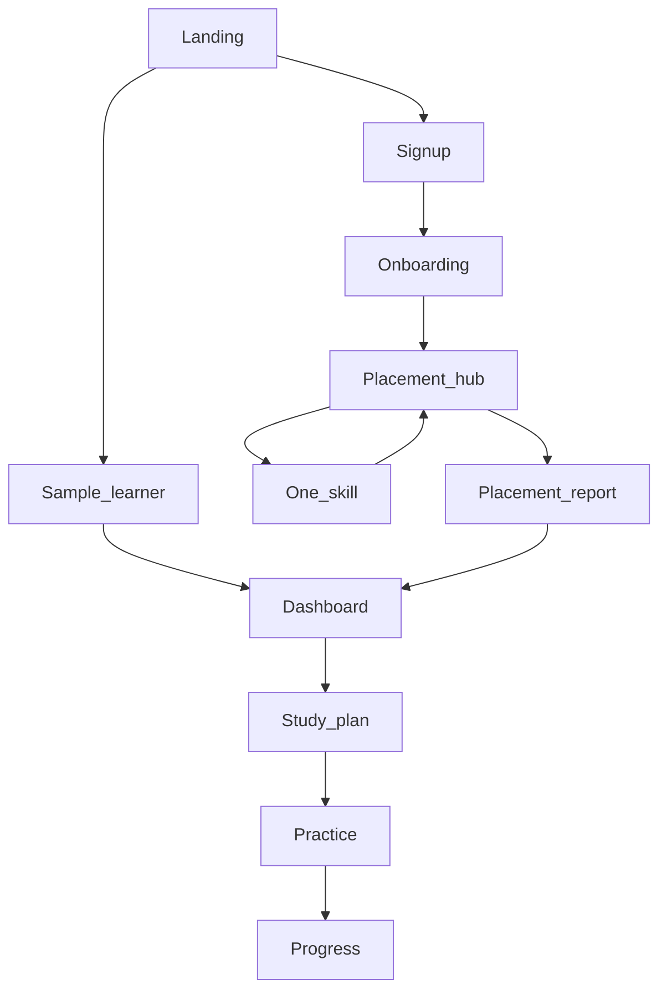
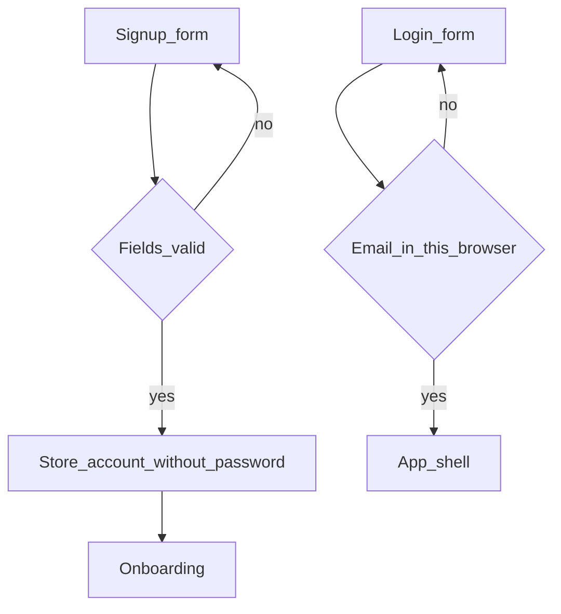
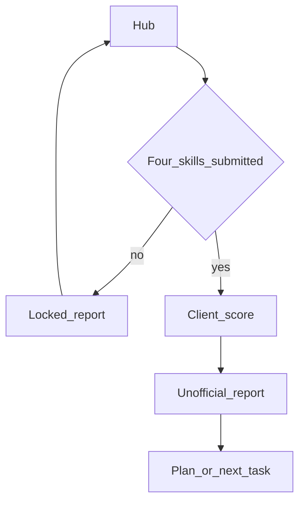
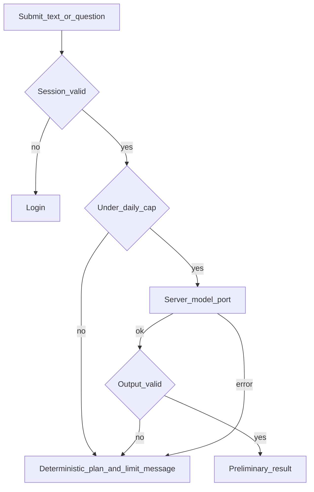
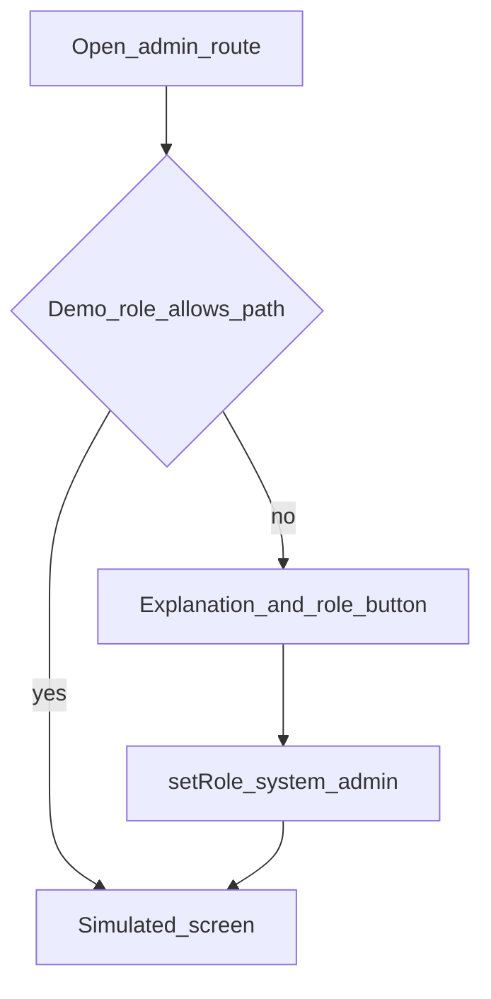

# Bandora user flows

Status: 2026-11-05. Each flow says what the prototype does now, then what production must do. Prototype connectivity is a local flag (`waitForConnection` in `lib/store.tsx`), not a network API.

## 1. New user

| | Prototype now | Production |
| --- | --- | --- |
| Entry | `/` | `/` |
| Action | Read the disclaimer and start signup, or open the sample | Start signup |
| System | Signup route or `signInDemo` | Signup route |
| Success | Sample opens a full scenario B dashboard. Signup goes to onboarding | Account exists and onboarding opens |
| Failure | None on the landing page | Landing stays static if the API is down, and says the service is unavailable |
| Recovery | Refresh | Retry |

The sample path is a prototype tool. It is not a production persona.

## 2. Registration and authentication

| | |
| --- | --- |
| Entry | `/signup` or `/login` |
| Action | Submit name, email, phone, age, and password, or email and password |
| System now | Validates the password, discards it, saves `Account` in `localStorage` key `ielts-readiness-state`. Login accepts any valid password for a stored email. `negar@example.com` and `admin@example.com` are built-in demos |
| Decision | Invalid field stays on the form. Unknown email stays on login |
| Success | Shell opens. New accounts still need onboarding |
| Failure | Validation message on the field |
| Production | `POST /v1/auth/register` and `POST /v1/auth/login` from `docs/api.md`. Session cookie is httpOnly. Wrong password and unknown email share one message. A missing or expired session sends the person to login |

Interrupted signup keeps nothing, because the account is written only after a valid submit.

## 3. Onboarding

| | |
| --- | --- |
| Entry | First shell visit, or `/onboarding` |
| Action | Set exam type, target, minutes, days, and timing |
| System now | `AppShell` redirects here until `onboardingDone` |
| Decision | Incomplete required fields do not finish onboarding |
| Success | Profile stored. Next page is placement |
| Failure | Field errors. No estimate is shown |
| Incomplete return | The shell sends them back here |
| Production | `PATCH /v1/me`. A failed save keeps the typed values and offers retry |

## 4. Placement assessment

| | |
| --- | --- |
| Entry | `/placement` |
| Action | Open one skill, answer, submit |
| System now | Marks that skill done in `state.placement` |
| Decision | Unanswered required items do not submit. If the local connection flag is offline, submit stops and the clock keeps running (`docs/decisions.md` D4) |
| Success | Return to the hub with that skill complete |
| Failure | Stay on the skill with the answers kept |
| Interrupted | Refresh restores `localStorage`. Production restores `placement_answers` for the open attempt |
| NOVI | Not on this flow |

## 5. Placement completion and analysis

| | |
| --- | --- |
| Entry | `/placement/report` |
| Action | Open the report after the fourth submit, or earlier |
| System now | Fewer than four skills and no view: locked. A fictional scenario can show labeled sample data. Otherwise `scorePlacement` and `buildView` |
| Success | Unofficial band, range, confidence, evidence |
| Failure | Locked state with a link to the hub. No invented band |
| Production | `POST /v1/placement/{id}/submit` only when four skills are closed. Report `GET` returns the same honesty fields. Model commentary is optional and labeled preliminary. If it fails, the numeric report still renders |

## 6. First dashboard visit

| | |
| --- | --- |
| Entry | `/dashboard` |
| No view | Encouraging NOVI sentence and “Start the placement” |
| View with a gap | Concerned NOVI names the bottleneck. Primary control opens the next task |
| View without a gap | Encouraging or happy sentence, still one next task |
| Success | The person can name the next action without opening another page |
| Failure | Do not show 0.0 as a result when placement is unfinished |

## 7. Daily study

| | |
| --- | --- |
| Entry | Dashboard after a previous session in this browser |
| Action | Read the next task, open practice or the plan |
| System now | The view is rebuilt from scenario data or from local placement plus edits |
| Success | One exercise or one plan task is completed and recorded locally |
| Failure | Missing local state returns the empty dashboard, not a broken chart |
| Production | The same screen reads server plan and latest snapshot. Offline shows the last successful snapshot and disables submit |

## 8. Study plan editing

| | |
| --- | --- |
| Entry | `/plan` |
| Action | Change status, priority, or load |
| System now | `taskEdits` update `buildView`, and coverage changes on the page |
| Decision | Edits apply immediately. There is no save button and no drag. Adherence under 75 shows the warning callout. A standing note explains the cost if the trailing skill loses minutes |
| Success | Coverage on this page changes, and the dashboard’s next task follows the edited plan |
| Failure | No view: empty state linking to placement. Nothing is editable |
| Interrupted | Edits already in `localStorage` survive refresh. Production saves with the plan version and returns 409 if another device saved first (`docs/api.md`) |
| NOVI | One sentence on this route, including after an edit. Do not change that sentence while a control is focused |

## 9. Practice session

| | |
| --- | --- |
| Entry | `/practice`, then `/practice/:id` |
| Action | Filter, start, answer, submit |
| System now | Objective items are graded from `lib/questions.ts`. The attempt is stored locally |
| Success | Result and a way to repeat |
| Failure | Validation on empty required answers |
| Interrupted | Local state keeps a submitted attempt. An unsent attempt follows the same offline rule as placement: do not pretend it was saved on a server |
| Model | Not during the timer. After an objective miss, AI-03 may explain. On failure, show the bank’s correct answer only |

## 10. Mock test

| | |
| --- | --- |
| Entry | `/mocks/:id` |
| Action | Start the timed paper and submit |
| System now | `scoreMockPaper` on the client. Clock continues across the simulated disconnect. Submit waits |
| Success | Unofficial result stored locally |
| Failure | Held submit, answers kept, retry when the connection flag is clear |
| NOVI | Absent for the whole runner |
| Production | Server clock. Answers saved incrementally. Scoring service returns band, range, confidence, and evidence |

## 11. AI feedback

This flow does not exist. The prototype path is the keyword assistant.

| Use case | Entry | Success | Recovery |
| --- | --- | --- | --- |
| Writing | After a writing submit | Preliminary band, notes, limitation, next step | Heuristic result only if labeled heuristic, plus the plan link |
| Typed speaking | After a speaking submit | Same, plus “pronunciation was not assessed” | Same, without a pronunciation number |
| Mistake explanation | After an objective result | Explanation that matches the bank answer | Bank answer only |
| Recommendation | Dashboard or plan action | A task id that is already on the plan | The deterministic next task |
| Assistant | `/assistant` | Reply grounded in the stored summary | Labeled template fallback, or a plain error if even that is wrong for the moment |

The assistant screen today starts with the sentence that it is not a language model. That sentence stays until AI-05 is really calling the server.

## 12. Progress review

| | |
| --- | --- |
| Entry | `/progress` or the dashboard trend |
| Action | Read history |
| Empty | Explain that no attempts exist yet |
| Success | Points match stored attempts and the placement |
| Failure | A date filter with no rows is an empty state, not an error. This is how `/reports` behaves now |

## 13. Subscription and payment

Not implemented. `/plans` compares Free and Pro and has no purchase action.

| | |
| --- | --- |
| Entry | `/plans` |
| Action now | Read and leave |
| Production MVP | No payment step |
| Future | A provider, a server `Subscription` row, and a return URL. Do not build this in Phases 0–4 |

## 14. Password recovery

| | |
| --- | --- |
| Entry | `/forgot-password` |
| Action | Submit an email |
| System now | Validates the email. If the local flag is offline, says no email was sent. Otherwise still says no email was sent |
| Success now | The person understands nothing was sent |
| Production | Same on-screen confirmation for every well-formed email. One message is sent only if the account exists. The link expires and can be used once |

## 15. Account deletion

| | |
| --- | --- |
| Entry | Profile |
| Action now | `deleteLocalAccount` removes `ielts-readiness-state` and resets state |
| Success now | Login wall. Data is gone from this browser only |
| Failure | If storage cannot be cleared, stay on profile and say it failed. Today the code does not show a separate failure branch |
| Production | Confirm by typing the email. `DELETE /v1/me` removes the user and cascaded attempts, plans, and model turns. Then the session ends |

## 16. Admin access

| | |
| --- | --- |
| Entry | `/admin` or a child route |
| System now | `canOpen`. Failure offers a button that promotes the same user |
| Success now | The simulated page renders. It is not an authorization success |
| Production | No promote button. 403 for the wrong server role. Sensitive writes append an audit row. Public release either has this or does not mount the routes |

## 17. Cross-cutting recovery

| Situation | Required handling |
| --- | --- |
| Onboarding incomplete | Shell returns to `/onboarding` |
| Placement incomplete | Dashboard empty state. Report locked |
| No local or server data | Empty states named in `docs/UX_ARCHITECTURE.md`. No zero-band masquerading as a result |
| API or model failure | Page content that is already deterministic still shows. Model area shows unavailable |
| Interrupted timed session | Clock keeps running. Submit is held. Answers already saved are kept |
| Expired session | Return to login. Do not leave admin data on screen |
